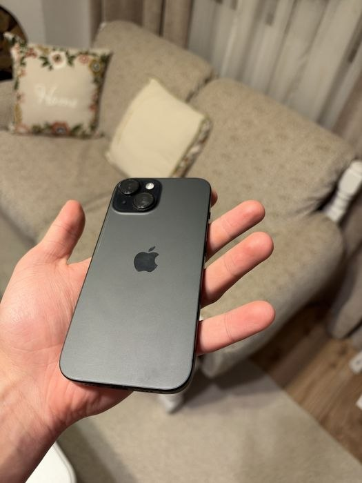
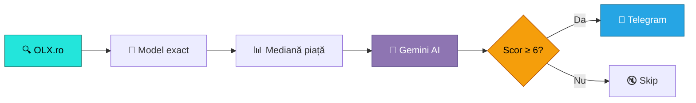

<div align="center">


# 📱 Alecs OLX RO

[](https://www.python.org/)
[](https://www.olx.ro/)
[](https://t.me/alecss12)
[](https://aistudio.google.com/)
[](LICENSE)
[](https://github.com/alecssdeveloper1/alecs-olx-ro)


**Bot Telegram pentru arbitraj pe telefoane** — găsește chilipiruri pe OLX.ro, pe **model exact**, le notează cu AI și te anunță instant.

<br/>

### 🔔 Exemplu alertă reală din bot



<table>
<tr><td>

📊 <b>SCOR IA: 6/10 (TIER B)</b><br/><br/>
📦 <b>Produs:</b> iPhone 15 128 GB<br/>
💰 <b>Preț cerut:</b> 1.500,00 lei<br/>
📊 <b>Comparație cu piața:</b><br/>
• Mediană observată: <b>1.800,00 lei</b> (38 anunțuri)<br/>
• Prețul este cu <b>16,7%</b> sub mediana pieței<br/><br/>
🧠 <b>Concluzie:</b> Ofertă acceptabilă pentru arbitraj datorită prețului sub medie, însă marja este modestă având în vedere defectele estetice raportate.<br/><br/>
⚙️ <b>Analiză tehnică:</b> Modelul corespunde căutării, însă starea estetică prezintă urme de uzură și o ciobitură, ceea ce poate limita revânzarea.<br/><br/>
📈 <b>Analiză de piață:</b> Prețul este cu 16,7% sub mediana pieței, oferind o marjă de profit potențială de <b>120 lei</b>.<br/><br/>
🔗 <a href="https://www.olx.ro/d/oferta/iphone-15-128-gb-IDl7UDL.html">Deschide anunțul pe OLX</a>

</td></tr>
</table>

<br/>

[](https://wa.me/40732159658)
[](https://t.me/alecss12)

</div>

---

## ✨ Ce face

| Pas | Acțiune |
|:---:|:---|
| 1️⃣ | Monitorizează căutările pe **OLX.ro** (toată țara) |
| 2️⃣ | Filtrează **modelul exact** (`honor 600` ≠ Smart/Pro) |
| 3️⃣ | Compară prețul cu **mediana** pieței locale |
| 4️⃣ | Evaluează cu **Gemini** → scor 0–10 / Tier S·A·B·C |
| 5️⃣ | Trimite alertă Telegram dacă scorul e **≥ 6** |

> Optimizat pentru **telefoane** (iPhone, Samsung, Honor, Xiaomi…). GPU/console rămân suportate secundar.

---

## 🏗 Flux



---

## 📂 Structură

```text
alecs-olx-ro/
├── assets/
│   ├── banner.jpeg
│   └── exemplu-alerta-iphone15.jpg   ← exemplu alertă reală
├── monitor.py               # scraping + Telegram + AI
├── olx_ro.py                # OLX.ro + prețuri lei + model exact
├── market_analytics.py      # mediană / marjă / lichiditate telefoane
├── benchmarks.py            # checklist flip telefoane
├── tests/
├── requirements.txt
└── .env.example
```

---

## 🚀 Instalare (PC sau VPS)

### Cerințe
- Python **3.10+**
- Token de la [@BotFather](https://t.me/BotFather)
- Cheie de la [Google AI Studio](https://aistudio.google.com/)

### Pași

```bash
git clone https://github.com/alecssdeveloper1/alecs-olx-ro.git
cd alecs-olx-ro

python3 -m venv .venv
source .venv/bin/activate          # Windows: .venv\Scripts\activate

pip install -r requirements.txt
cp .env.example .env
```

Editează `.env`:

```env
TELEGRAM_TOKEN="tokenul_tau_telegram"
GEMINI_API_KEY="cheia_ta_gemini"
INTERVALO_SEGUNDOS=90
```

### Pornire

```bash
python -u monitor.py
```

În Telegram → deschide botul → **`/start`**

---

## 🖥 VPS 24/7 (systemd)

```bash
sudo nano /etc/systemd/system/alecs-olx.service
```

```ini
[Unit]
Description=Alecs OLX RO Bot
After=network.target

[Service]
Type=simple
User=USER
WorkingDirectory=/home/USER/alecs-olx-ro
Environment=PYTHONUNBUFFERED=1
ExecStart=/home/USER/alecs-olx-ro/.venv/bin/python -u /home/USER/alecs-olx-ro/monitor.py
Restart=always
RestartSec=15

[Install]
WantedBy=multi-user.target
```

```bash
sudo systemctl daemon-reload
sudo systemctl enable --now alecs-olx.service
journalctl -u alecs-olx.service -f
```

---

## 📲 Cum se folosește

Trimite **`/start`** — apar butoanele:

| Buton | Acțiune |
|:---|:---|
| ➕ **Adaugă** | Apoi scrii: `honor 600 1500` |
| 📋 **Listă** | Căutările active |
| 🗑 **Șterge** | Alegi modelul de eliminat |
| 🏆 **Top** | Oferte 8–10/10 |
| 📊 **Tierlist** | Top pe căutările tale |
| ❓ **Ajutor** | Ghid rapid |

### Exemple

```text
honor 600 1500
iphone 12 1200
samsung s23 1800
honor 600 pro 2500
```

Poți scrie și natural: *„Caut iPhone 13 până la 2.000 lei”*.

### Reguli
- Scrie **modelul exact** pe care vrei să-l revinzi
- `iphone 12` ≠ 12 Pro · `honor 600` ≠ Smart/Pro
- Ignoră accesorii/piese (husă, folie, display…)
- Alertă doar la scor **≥ 6** și sub plafonul tău
- Scanare ~**90s**, toate paginile fiecărei căutări (OLX se oprește la 25), anunțuri ordonate de la cele mai noi

---

## ⚠️ Disclaimer

Automatizarea pe OLX poate fi restricționată. Folosește responsabil.  
Lichiditatea / timpul de vânzare = **euristici**, nu garanții.  
La HTTP **403/429** botul oprește scanarea până la restart.


---

<div align="center">

### 📞 Contact

[](https://wa.me/40732159658)
[](https://t.me/alecss12)

<br/>

**Alecs OLX RO** · telefoane · model exact · profit

</div>
